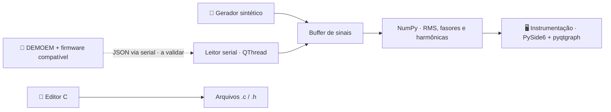

<div align="center">

# ◈ PRISMA

**Plataforma de Registro, Instrumentação, Sinais, Medição e Análise**<br>
Programar. Medir. Analisar.

Um ambiente desktop para explorar sinais elétricos e desenvolver sistemas embarcados.

[](https://github.com/frahncky/PRISMA/actions/workflows/ci.yml)
[](https://www.python.org/downloads/)
[](https://doc.qt.io/qtforpython-6/)


[**🚀 Como executar**](#-como-executar) &nbsp;·&nbsp;
[**📡 Protocolo serial**](docs/protocolo.md) &nbsp;·&nbsp;
[**🗺️ Roadmap**](docs/roadmap.md)


<sub>Captura real do aplicativo em modo demonstração. Os sinais exibidos são sintéticos.</sub>

</div>

---

## 🎯 Visão geral

O **PRISMA** reúne instrumentos virtuais, editor de código C e leitura de telemetria serial em uma interface desktop em português, voltada ao Windows. O primeiro hardware-alvo é o **kit DEMOEM / MCF51EM256 (ColdFire V1)**.

A proposta é aproximar programação embarcada e análise de sinais em um mesmo ambiente: visualizar formas de onda, comparar fases e acompanhar medições enquanto a integração com a bancada evolui.

> [!NOTE]
> **Protótipo v0.1.0:** o aplicativo inicia em demonstração e funciona sem placa. A leitura serial está implementada em software, mas ainda não foi validada na DEMOEM. Compilação ColdFire, gravação BDM e depuração estão planejadas.

## ✨ Recursos

| Área | O que está disponível |
| --- | --- |
| 📈 **Osciloscópio** | Visualização simultânea das tensões Va, Vb e Vc. |
| 🧭 **Fasores** | Diagrama com módulo e ângulo das três fases, usando referência fixa de 60 Hz. |
| ⚡ **Valores RMS** | Indicadores por fase calculados sobre os sinais sem componente contínua. |
| 📊 **Harmônicas e THD** | Espectro da fase A até h15, limitado pela taxa de amostragem, e THD estimada das ordens disponíveis. |
| 🧪 **Demonstração** | Sinais trifásicos sintéticos de 60 Hz, com terceira harmônica de 2,5% na fase A. |
| 📡 **Aquisição serial** | Seleção de porta COM, leitura de JSON por linha a 115200 baud e console de comunicação. |
| 📝 **Editor C** | Abertura e salvamento de arquivos `.c` e `.h`, com esqueleto ilustrativo para o hardware-alvo. |

## 🚀 Como executar

**Pré-requisitos:** Windows 11, [Python 3.11 ou superior](https://www.python.org/downloads/) e Git para clonar o repositório.

No PowerShell:

```powershell
git clone https://github.com/frahncky/PRISMA.git
cd PRISMA
py -m venv .venv
.\.venv\Scripts\python.exe -m pip install -e ".[dev]"
.\.venv\Scripts\python.exe -m prisma
```

O aplicativo abre em **modo demonstração**, sem necessidade da DEMOEM. A aba **Instrumentação** apresenta os gráficos e indicadores; **Firmware C (editor)** permite abrir e editar código.

### Entendendo a demonstração

O gerador produz **2400 amostras/s**, suficientes para analisar até a 15ª harmônica de 60 Hz. As fases têm valor nominal de 127 V RMS, e a fase A inclui uma terceira harmônica de 2,5%.

Na aquisição serial, o maior intervalo entre amostras define o limite das ordens exibidas, sempre abaixo de Nyquist. A THD informa o intervalo analisado; quando nem a segunda harmônica pode ser medida, aparece como indisponível. Esses resultados são estimativas e dependem da janela de análise e da qualidade da aquisição.

## 📡 Comunicação com a bancada

1. Confirme se o Windows reconhece uma **porta COM** e se os drivers e jumpers da placa estão corretos.
2. Utilize firmware compatível com o [protocolo PRISMA v1](docs/protocolo.md).
3. No aplicativo, clique em **Atualizar COM**, selecione a porta e use **Conectar serial**.
4. Acompanhe o estado da conexão e as mensagens no console. Para retornar aos sinais sintéticos, clique em **Modo demo**.

A comunicação utiliza **115200 baud, 8N1**, com uma mensagem JSON UTF-8 por linha:

```json
{"type":"sample","t":0.001,"va":110.2,"vb":-92.1,"vc":-18.3}
```

| Campo | Significado |
| --- | --- |
| `type` | Identificador fixo `sample`. |
| `t` | Instante em segundos, estritamente crescente. |
| `va`, `vb`, `vc` | Valores instantâneos das três fases, em volts. |

O firmware deve converter as leituras do ADC para unidades físicas. A presença do dispositivo **“BDM Serial Interface”** não comprova, sozinha, que exista uma COM funcional. O protocolo JSON é uma convenção do PRISMA, e não um protocolo nativo do MCF51EM256.

## 🧱 Arquitetura



A interface roda na thread principal do Qt; a leitura serial usa uma `QThread` própria. O núcleo separa protocolo, armazenamento temporário de amostras e cálculos para permitir a evolução dos instrumentos e dos adaptadores de hardware.

| Camada | Tecnologias |
| --- | --- |
| Aplicativo | Python 3.11+, PySide6 |
| Visualização | pyqtgraph |
| Processamento | NumPy |
| Comunicação | pyserial, JSON por linha |
| Validação | pytest, GitHub Actions |

## 🗂️ Estrutura do repositório

```text
src/prisma/
  main.py               Entrada do aplicativo
  ui/                   Janela, instrumentos e editor C
  core/                 Protocolo, buffer, cálculos e leitura serial
docs/                   Arquitetura, protocolo, roadmap e imagens
examples/               Exemplo de telemetria JSON por linha
firmware/               Orientações para a integração planejada com a DEMOEM
scripts/                Diagnóstico de drivers no Windows
tests/                  Testes de protocolo, cálculos e interface Qt
.github/workflows/      Validação automatizada
```

## 🗺️ Estado e próximos passos

| Entrega | Estado |
| --- | --- |
| Interface, editor C e instrumentos em demonstração | ✅ Implementado |
| Harmônicas limitadas à taxa de amostragem | ✅ Implementado |
| Leitura serial JSON | 🧪 Implementado em software; validação na DEMOEM pendente |
| Drivers USB/BDM, porta COM e ligações da bancada | ⏳ A validar |
| Firmware de telemetria para MCF51EM256 | ⏳ Planejado |
| Histórico CSV/SQLite | ⏳ Planejado |
| Compilação ColdFire, gravação BDM e depuração | ⏳ Planejado |
| Frequência dinâmica, calibração e análise de potência | ⏳ Planejado |

As etapas e os objetivos de cada fase estão no [roadmap](docs/roadmap.md).

## 🛠️ Desenvolvimento e testes

Com o ambiente de instalação preparado:

```powershell
.\.venv\Scripts\python.exe -m compileall -q src
.\.venv\Scripts\python.exe -m pytest -q
```

Os testes cobrem o protocolo, a ordenação temporal, os cálculos trifásicos, os limites de Nyquist e a atualização dos instrumentos Qt em modo sem tela. O [GitHub Actions](https://github.com/frahncky/PRISMA/actions/workflows/ci.yml) executa a compilação dos módulos e a suíte de testes a cada push ou pull request.

## 📚 Documentação

| Guia | Conteúdo |
| --- | --- |
| [Arquitetura](docs/arquitetura.md) | Camadas do aplicativo e integração com o MCF51EM256. |
| [Protocolo serial](docs/protocolo.md) | Formato das amostras, unidades e limites da telemetria. |
| [Roadmap](docs/roadmap.md) | Etapas de aquisição, programação e instrumentação avançada. |
| [Firmware](firmware/README.md) | Situação e requisitos da integração com a DEMOEM. |
| [Exemplo de telemetria](examples/telemetria_exemplo.jsonl) | Amostras no formato JSON por linha. |
| [Diagnóstico Windows](scripts/diagnostico_windows.ps1) | Script de apoio à identificação de dispositivos e drivers. |

## ⚠️ Uso em bancada

Não conecte tensão de rede diretamente aos pinos do microcontrolador. A aquisição de grandezas elétricas exige condicionamento e isolamento apropriados. Os gráficos são estimativas não calibradas nem certificadas; seu uso como instrumento físico depende da validação da cadeia de medição.

## 🔒 Licença e uso

Nenhuma licença de uso ou redistribuição foi definida. O projeto é identificado como proprietário nos metadados do pacote, sem concessão de licença.

---

<div align="center">

<sub>PRISMA · Programar. Medir. Analisar.</sub>

</div>
