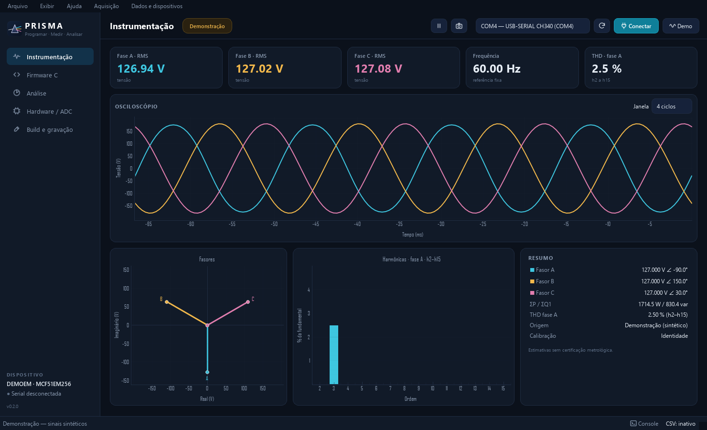
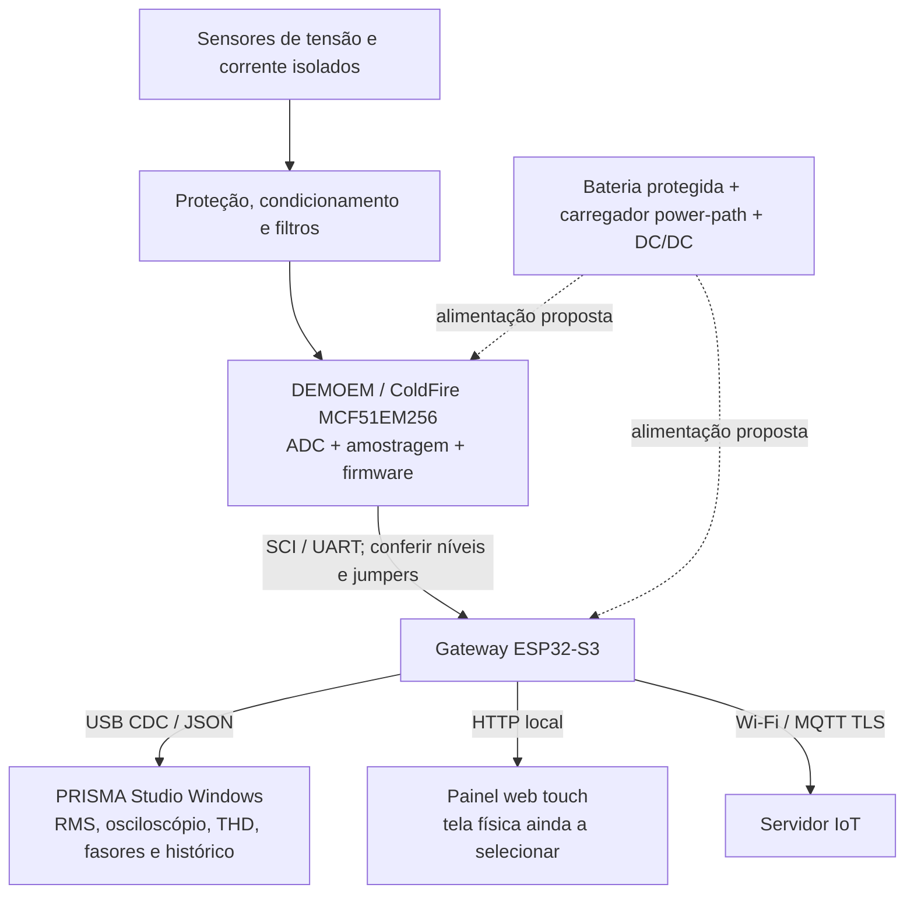
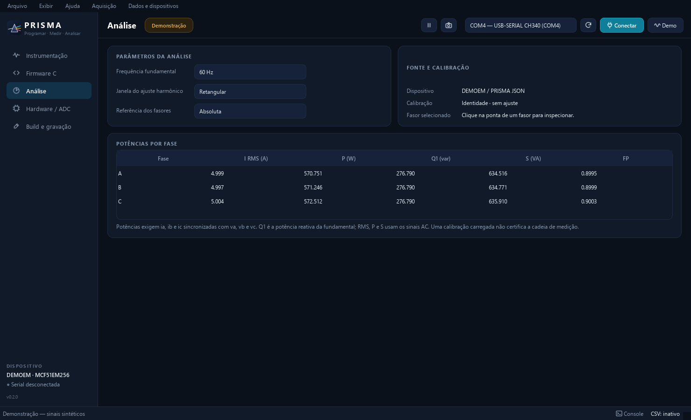
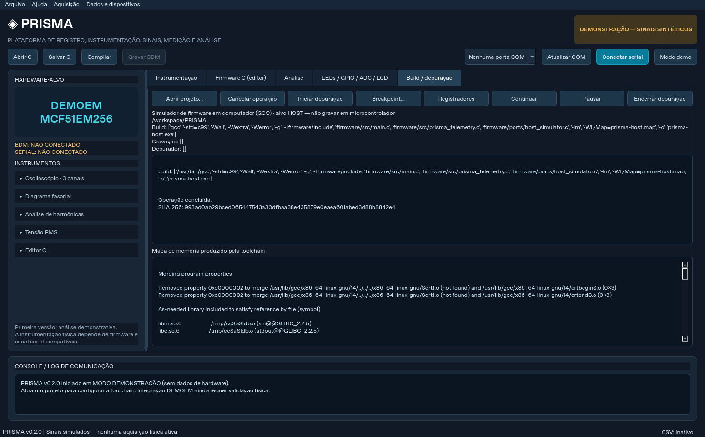
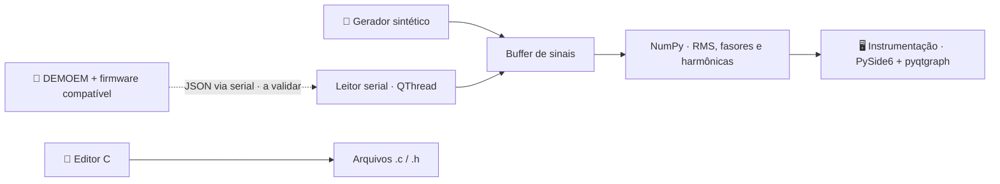

<div align="center">

# ◈ PRISMA

**Plataforma de Registro, Instrumentação, Sinais, Medição e Análise**<br>
Programar. Medir. Analisar.

**Sistema de medição, supervisão e comunicação IoT baseado na DEMOEM / ColdFire MCF51EM256.**

Aquisição elétrica · Instrumentação · Tela touch · Bateria interna · Wi-Fi/MQTT

[](https://github.com/frahncky/PRISMA/actions/workflows/ci.yml)
[](https://www.python.org/downloads/)
[](https://doc.qt.io/qtforpython-6/)
 

[**🧩 Sistema e hardware**](#-sistema-prisma--placa-touch-bateria-e-iot) &nbsp;·&nbsp;
[**🔌 Guia de ligações**](docs/ligacoes-hardware-demoem.md) &nbsp;·&nbsp;
[**🚀 Executar**](#-como-executar) &nbsp;·&nbsp;
[**🗺️ Roadmap**](docs/roadmap.md)



<sub>Captura real do aplicativo em modo demonstração. Os sinais exibidos são sintéticos.</sub>

</div>

---

## 🎯 Visão geral

O **PRISMA** reúne instrumentos virtuais, editor de código C e leitura de telemetria serial em uma interface desktop em português, voltada ao Windows. O primeiro hardware-alvo é o **kit DEMOEM / MCF51EM256 (ColdFire V1)**.

A proposta é aproximar programação embarcada e análise de sinais em um mesmo ambiente: visualizar formas de onda, comparar fases e acompanhar medições enquanto a integração com a bancada evolui.

> [!NOTE]
> **Protótipo v0.2.0:** inicia em demonstração e funciona sem placa. Histórico, instrumentação avançada e execução configurável de ferramentas estão disponíveis. A aquisição e a toolchain reais na DEMOEM ainda precisam de validação física; não há firmware ColdFire homologado incluído.

## 🧩 Sistema PRISMA — placa, touch, bateria e IoT

O **PRISMA** está evoluindo de uma interface desktop para um **sistema integrado de medição de energia**, preservando a **DEMOEM/MCF51EM256** como unidade de aquisição. A expansão prevista usa **ESP32-S3** para supervisão touch e transmissão IoT. A documentação distingue funções já implementadas de integrações que ainda exigem testes físicos.



### Componentes e situação real

| Módulo | Recursos | Estado |
| --- | --- | --- |
| **Placa DEMOEM** | MCF51EM256, entradas analógicas, SCI e interface BDM | Hardware-alvo **identificado**; revisão, pinagem definitiva e testes físicos pendentes |
| **Aquisição de dados reais** | Sensores de tensão e corrente isolados, filtragem, ADC e calibração | **Pendente** de sensores/AFE, mapeamento dos canais, firmware ColdFire e validação |
| **PRISMA desktop** | Osciloscópio, RMS, fasores, harmônicas/THD, potências, CSV/SQLite e leitura serial | **Implementado em software**; abre em demonstração sem a placa |
| **Gateway ESP32-S3** | Recepção UART, retransmissão USB CDC, resumo RMS AC, painel web e MQTT/TLS | **Código-fonte publicado** em `gateway/esp32s3/`; build PlatformIO e integração física **não testados** |
| **Interface touch** | Painel web responsivo servido pelo ESP32-S3 | **HTML/CSS/JS implementado em código**; nenhum TFT físico conectado ou driver de display selecionado |
| **Bateria interna** | Li-ion/LiPo protegida, carregamento power-path e DC/DC | **Projeto de integração**, sem circuito de carga homologado |

### Como ligar a plataforma

| Subsistema | Caminho e cuidados |
| --- | --- |
| **Alimentação DEMOEM** | USB 5 V ou jack 6 V DC centro positivo, segundo manual e revisão; conferir **J3/J4/J24** |
| **Medições reais** | Transdutores **isolados**, proteção e condicionamento; revisar **J29/J38**, ADC e sinais de demonstração |
| **Gateway IoT** | SCI3 na DEMOEM (referência **J6**, seleção **J9/J10**, interface **J7/J8**) → UART do ESP32-S3, após validação elétrica |
| **Tela touch** | Módulo de tela compatível com ESP32-S3; o LCD de segmentos **J26/J27 não funciona como TFT** |
| **Bateria** | Pack protegido + gerenciamento de carga + reguladores apropriados; a **CR2032 só mantém o relógio** |
| **Dados** | PRISMA JSON v1 a 115200 8N1 quando a vazão permitir; MQTT/TLS para telemetria de resumos via Wi-Fi |

**Código do gateway:** [ESP32-S3 / PlatformIO, firmware e painel web touch](gateway/esp32s3/README.md) · [main.cpp](gateway/esp32s3/src/main.cpp) · [painel HTML](gateway/esp32s3/include/dashboard.h).

**Documentação:** [Guia detalhado da placa](docs/ligacoes-hardware-demoem.md) · [Roteiro de bancada](docs/bancada-demoem.md) · [Protocolo serial](docs/protocolo.md) · [Firmware ColdFire](firmware/README.md) · [Arquitetura](docs/arquitetura.md).

> [!WARNING]
> **Ainda não há medição real homologada na DEMOEM, firmware ColdFire validado ou tela/bateria física integrada.** Nunca conectar tensão de rede diretamente ao ADC, ligar bateria à lógica ou acoplar alimentação USB/externa sem verificar isolamento, reguladores e retornos de corrente.

## ✨ Recursos

| Área | O que está disponível |
| --- | --- |
| 📈 **Osciloscópio** | Visualização simultânea das tensões Va, Vb e Vc. |
| 🧭 **Fasores** | Diagrama selecionável, com referência visual absoluta ou relativa a uma fase e referência de 50/60 Hz ou frequência estimada. |
| ⚡ **Valores RMS** | Indicadores por fase calculados sobre os sinais sem componente contínua. |
| 📊 **Harmônicas e THD** | Ajuste harmônico até h15, limitado por Nyquist, com THD, janela retangular ou Hann e frequência automática entre 40 e 70 Hz. |
| 🧪 **Demonstração** | Sinais trifásicos sintéticos de 60 Hz, com terceira harmônica de 2,5% na fase A. |
| 📡 **Aquisição serial** | Seleção de porta COM, leitura de JSON por linha a 115200 baud e console de comunicação. |
| 📝 **Editor C** | Abertura e salvamento de arquivos `.c` e `.h`, com esqueleto ilustrativo para o hardware-alvo. |
| 💾 **CSV e SQLite** | Registro incremental, sessões, consulta, filtro temporal e exportação, com origem e calibração. |
| 🔋 **Potências AC** | Correntes RMS, P, Q da fundamental, S e fator de potência quando há correntes trifásicas sincronizadas. |
| 📐 **Calibração e relatórios** | Ganho/offset por canal e relatório HTML autossuficiente da última análise válida. |
| 🔧 **Build e depuração** | Projetos com comandos configuráveis, log, mapa de memória, hash do artefato, confirmação de gravação e cliente GDB/MI. |
| 🔌 **Perfis, plugins e estados** | Protocolos JSON/CSV, API de plugins instaláveis, diagnóstico USB/serial e recepção de LED/GPIO/ADC/LCD via JSON. |

## 🖼️ Telas

<table>
  <tr>
    <td align="center" width="50%"><br><sub>Análise, calibração ativa e potências AC em demonstração.</sub></td>
    <td align="center" width="50%"><br><sub>Build real do simulador no computador; não é compilação ColdFire.</sub></td>
  </tr>
</table>

## 🚀 Como executar

**Pré-requisitos:** Windows 11, [Python 3.11 ou superior](https://www.python.org/downloads/) e Git para clonar o repositório.

No PowerShell:

```powershell
git clone https://github.com/frahncky/PRISMA.git
cd PRISMA
py -m venv .venv
.\.venv\Scripts\python.exe -m pip install -e ".[dev]"
.\.venv\Scripts\python.exe -m prisma
```

O aplicativo abre em **modo demonstração**, sem necessidade da DEMOEM. A aba **Instrumentação** apresenta os gráficos e indicadores; **Firmware C (editor)** permite abrir e editar código.

### Entendendo a demonstração

O gerador produz **2400 amostras/s**, suficientes para analisar até a 15ª harmônica de 60 Hz. As fases têm valor nominal de 127 V RMS, e a fase A inclui uma terceira harmônica de 2,5%.

Na aquisição serial, o maior intervalo entre amostras define o limite das ordens exibidas, sempre abaixo de Nyquist. A THD informa o intervalo analisado; quando nem a segunda harmônica pode ser medida, aparece como indisponível. Esses resultados são estimativas e dependem da janela de análise e da qualidade da aquisição.

## 💾 Registrar amostras em CSV

Com o modo demo ativo ou a serial recebendo amostras, abra **Aquisição → Iniciar registro CSV…** e escolha o arquivo. O indicador na barra de status mostra a quantidade registrada. Para concluir, use **Aquisição → Parar registro**.

O arquivo contém as colunas `t_s`, `va_V`, `vb_V`, `vc_V`, `ia_A`, `ib_A`, `ic_A` e `origem`, em UTF-8, com vírgula como separador e ponto decimal. O registro começa nas próximas amostras recebidas e continua além da janela dos gráficos, sem manter todo o histórico em memória. A origem identifica demonstração ou aquisição serial e, nesta última, a porta utilizada.

Trocar a fonte de dados, desconectar a serial ou fechar o aplicativo encerra o arquivo. Uma nova aquisição exige iniciar outro registro. Em caso de falha de escrita, o console informa o erro e o registro para; a visualização continua. Em **Dados e dispositivos → Iniciar histórico SQLite…**, registre sessões no mesmo banco. **Consultar histórico SQLite…** lista as sessões e exporta uma delas, inteira ou filtrada por tempo, para CSV. Campos de corrente ausentes ficam vazios/NULL; origem e coeficientes de calibração acompanham os dados.

## 📐 Análise e relatórios

Na aba **Análise**, selecione 50 Hz, 60 Hz ou frequência automática (40–70 Hz), janela retangular/Hann e referência visual dos fasores. Clique na ponta de um fasor para inspecioná-lo. Carregue coeficientes por canal e exporte relatórios HTML pelo menu **Dados e dispositivos**. O HTML pode ser impresso em PDF pelo navegador.

A demonstração inclui correntes sintéticas de 5 A RMS, com atraso nominal correspondente a FP 0,9. Na serial, as potências exigem `ia`, `ib` e `ic` sincronizadas: P e S incluem distorção AC; Q1 é a potência reativa da fundamental. Consulte os [métodos e limites](docs/instrumentacao.md).

## 🔧 Compilação e depuração

Abra um projeto JSON na aba **Build / depuração** para configurar os executáveis e argumentos da toolchain instalada. A saída, os erros e o mapa de memória são apresentados na aba. Um build válido calcula o hash do artefato; a gravação exige comando de gravador configurado e confirmação explícita.

O [projeto GCC host](examples/projects/host-gcc.json) compila o simulador C no computador. O [template ColdFire](examples/projects/coldfire-template.json) exige os comandos reais da instalação CodeWarrior/PEmicro: não inclui uma receita pronta para a DEMOEM. A depuração usa GDB/MI e requer servidor e depurador compatíveis com o alvo. Leia o [guia da toolchain](docs/toolchain.md) antes de configurar a bancada.

## 📡 Comunicação com a bancada

1. Confirme se o Windows reconhece uma **porta COM** e se os drivers e jumpers da placa estão corretos.
2. Utilize firmware compatível com o [protocolo PRISMA v1](docs/protocolo.md).
3. No aplicativo, clique em **Atualizar COM**, selecione a porta e use **Conectar serial**.
4. Acompanhe o estado da conexão e as mensagens no console. Para retornar aos sinais sintéticos, clique em **Modo demo**.

A comunicação utiliza **115200 baud, 8N1**, com uma mensagem JSON UTF-8 por linha:

```json
{"type":"sample","t":0.001,"va":110.2,"vb":-92.1,"vc":-18.3}
```

| Campo | Significado |
| --- | --- |
| `type` | Identificador fixo `sample`. |
| `t` | Instante em segundos, estritamente crescente. |
| `va`, `vb`, `vc` | Valores instantâneos das três fases, em volts. |

O firmware deve converter as leituras do ADC para unidades físicas. A presença do dispositivo **“BDM Serial Interface”** não comprova, sozinha, que exista uma COM funcional. O protocolo JSON é uma convenção do PRISMA, e não um protocolo nativo do MCF51EM256.

## 🧱 Arquitetura



A interface roda na thread principal do Qt; a leitura serial usa uma `QThread` própria. O núcleo separa protocolo, armazenamento temporário de amostras e cálculos para permitir a evolução dos instrumentos e dos adaptadores de hardware.

| Camada | Tecnologias |
| --- | --- |
| Aplicativo | Python 3.11+, PySide6 |
| Visualização | pyqtgraph |
| Processamento | NumPy |
| Comunicação | pyserial, JSON por linha |
| Validação | pytest, GitHub Actions |

## 🗂️ Estrutura do repositório

```text
src/prisma/
  main.py               Entrada do aplicativo
  ui/                   Janela, instrumentos e editor C
  core/                 Protocolo, buffer, cálculos e leitura serial
docs/                   Arquitetura, protocolo, roadmap e imagens
examples/               Telemetria, calibração, perfis e projetos de toolchain
firmware/               Encoder C, HAL e simulador host; port DEMOEM pendente
scripts/                Diagnóstico de drivers no Windows
tests/                  Testes de protocolo, cálculos e interface Qt
.github/workflows/      Validação automatizada
```

## 🗺️ Estado e próximos passos

| Entrega | Estado |
| --- | --- |
| Interface, editor C e instrumentos em demonstração | ✅ Implementado |
| Harmônicas limitadas à taxa de amostragem | ✅ Implementado |
| Leitura serial JSON | 🧪 Implementado em software; validação na DEMOEM pendente |
| Drivers USB/BDM, porta COM e ligações da bancada | ⏳ A validar |
| Encoder de telemetria C e simulador host | ✅ Compilados e testados no computador |
| Port do firmware para MCF51EM256 | ⏳ Depende de revisão, pinagem e HAL da placa |
| Registro de amostras CSV | ✅ Implementado para demo e serial |
| Histórico SQLite, filtro temporal e exportação | ✅ Implementado |
| Executor de build/gravador e cliente GDB/MI | 🧪 Implementados; compatibilidade ColdFire/PEmicro pendente |
| Frequência dinâmica, calibração, janelamento e potência AC | ✅ Implementados em software |
| Homologação física de todas as fases | ⏳ Placa indisponível nesta sessão |

As entregas de software e as pendências físicas de cada fase estão no [roadmap](docs/roadmap.md). O [roteiro da bancada](docs/bancada-demoem.md) reúne os critérios para fechar a validação real, incluindo o limite de vazão de JSON na serial.

## 🛠️ Desenvolvimento e testes

Com o ambiente de instalação preparado:

```powershell
.\.venv\Scripts\python.exe -m compileall -q src
.\.venv\Scripts\python.exe -m pytest -q
```

Os testes cobrem protocolo, serial fragmentada, cálculos trifásicos, frequência, potência, calibração, limites de Nyquist, SQLite, relatórios e interface Qt sem tela. Também compilam o firmware host com GCC e validam sua saída no analisador real, além de testar execução assíncrona de ferramentas e comandos GDB/MI com processos de teste. O [GitHub Actions](https://github.com/frahncky/PRISMA/actions/workflows/ci.yml) executa a compilação dos módulos e a suíte de testes a cada push ou pull request.

## 📚 Documentação

As novidades estão no [histórico de versões](CHANGELOG.md).

| Guia | Conteúdo |
| --- | --- |
| [Arquitetura](docs/arquitetura.md) | Camadas do aplicativo e integração com o MCF51EM256. |
| [Protocolo serial](docs/protocolo.md) | Formato das amostras, unidades e limites da telemetria. |
| [Instrumentação](docs/instrumentacao.md) | Frequência, harmônicas, potências, calibração, histórico e relatórios. |
| [Toolchain](docs/toolchain.md) | Projetos, compilação, gravação e cliente de depuração. |
| [Perfis e plugins](docs/plugins.md) | Adaptadores JSON/CSV e API de protocolos instaláveis. |
| [Bancada DEMOEM](docs/bancada-demoem.md) | Identificação, jumpers, port, vazão serial e critérios físicos de aceitação. |
| [Ligações da placa DEMOEM](docs/ligacoes-hardware-demoem.md) | Alimentação, sensores e dados reais, SCI/UART, tela touch, bateria interna e gateway IoT ESP32-S3, com limites e testes. |
| [Gateway ESP32-S3](gateway/esp32s3/README.md) | Código PlatformIO, painel web touch, MQTT/TLS, ligação serial e passos de configuração. |
| [Roadmap](docs/roadmap.md) | Etapas de aquisição, programação e instrumentação avançada. |
| [Firmware](firmware/README.md) | Encoder C, simulador host e requisitos do port para DEMOEM. |
| [Exemplo de telemetria](examples/telemetria_exemplo.jsonl) | Amostras no formato JSON por linha. |
| [Diagnóstico Windows](scripts/diagnostico_windows.ps1) | Script de apoio à identificação de dispositivos e drivers. |

## ⚠️ Uso em bancada

Não conecte tensão de rede diretamente aos pinos do microcontrolador. A aquisição de grandezas elétricas exige condicionamento e isolamento apropriados. Os gráficos são estimativas não calibradas nem certificadas; seu uso como instrumento físico depende da validação da cadeia de medição.

## 🔒 Licença e uso

Nenhuma licença de uso ou redistribuição foi definida. O projeto é identificado como proprietário nos metadados do pacote, sem concessão de licença.

---

<div align="center">

<sub>PRISMA · Programar. Medir. Analisar.</sub>

</div>
