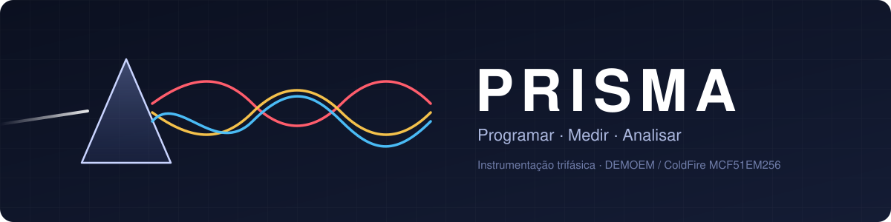
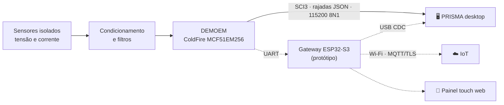

<div align="center">



### Plataforma de Registro, Instrumentação, Sinais, Medição e Análise

Osciloscópio, RMS, fasores, harmônicas e potências trifásicas em um app desktop em português,<br>
ligado por serial à placa **DEMOEM / ColdFire MCF51EM256**.

[](https://github.com/frahncky/PRISMA/actions/workflows/ci.yml)
[](https://www.python.org/downloads/)
[](https://doc.qt.io/qtforpython-6/)


**[Começar](#-começar-em-1-minuto)** ·
**[Recursos](#-recursos)** ·
**[Hardware](#-hardware-e-bancada)** ·
**[Estado](#-estado-do-projeto)** ·
**[Documentação](#-documentação)**

<br>


<sub>Captura real do aplicativo em modo demonstração · sinais sintéticos</sub>

</div>

<br>

> [!NOTE]
> **Protótipo v0.2.0.** Abre em modo demonstração e funciona sem placa. A DEMOEM já foi gravada e lida em bancada (CodeWarrior + PEmicro, telemetria via CH340). As leituras de ADC ainda são contagens brutas: a calibração metrológica está pendente.

## ⚡ Começar em 1 minuto

```powershell
git clone https://github.com/frahncky/PRISMA.git
cd PRISMA
py -m venv .venv
.\.venv\Scripts\python.exe -m pip install -e ".[dev]"
.\.venv\Scripts\python.exe -m prisma
```

Requer **Windows 11** e **Python 3.11+**. O app abre direto em demonstração: 2400 amostras/s, três fases de 127 V RMS a 60 Hz e 2,5 % de 3ª harmônica na fase A.

Com a placa:

```powershell
.\.venv\Scripts\python.exe -m prisma --port COM4 --profile examples\profiles\demoem-ch340.json --connect
.\.venv\Scripts\python.exe -m prisma --last          # reusa a última porta, perfil e monitor
.\scripts\criar_atalho.ps1                             # atalho "PRISMA" na área de trabalho
```

## ✨ Recursos

<table>
  <tr>
    <td width="33%" valign="top">
      <h3>📈 Instrumentos</h3>
      Osciloscópio trifásico, RMS por fase, diagrama fasorial interativo, harmônicas até h15 com THD, janela Hann/retangular e frequência automática 40–70 Hz.
    </td>
    <td width="33%" valign="top">
      <h3>🔋 Potência AC</h3>
      Correntes RMS, P, Q da fundamental, S e fator de potência quando há correntes trifásicas sincronizadas. Calibração ganho/offset por canal.
    </td>
    <td width="33%" valign="top">
      <h3>📡 Aquisição serial</h3>
      JSON por linha via COM, perfis por placa, plugins de protocolo (JSON/CSV) e diagnóstico USB/serial do Windows.
    </td>
  </tr>
  <tr>
    <td valign="top">
      <h3>💾 Histórico</h3>
      Registro CSV contínuo e sessões SQLite com filtro temporal e exportação, sempre com origem e coeficientes de calibração.
    </td>
    <td valign="top">
      <h3>🔧 Build e gravação</h3>
      Projetos JSON com toolchain configurável, log, mapa de memória, hash do artefato e confirmação antes de gravar. Build CodeWarrior por linha de comando.
    </td>
    <td valign="top">
      <h3>📝 Editor e relatórios</h3>
      Editor de firmware C (<code>.c</code>/<code>.h</code>) e relatório HTML autossuficiente da análise, pronto para imprimir em PDF.
    </td>
  </tr>
</table>

<table>
  <tr>
    <td align="center" width="50%"><br><sub>Análise, calibração e potências AC</sub></td>
    <td align="center" width="50%"><br><sub>Build com hash e mapa de memória</sub></td>
  </tr>
</table>

## 🧩 Como tudo se conecta



<sub>Linhas contínuas: caminho validado em bancada. Tracejadas: código publicado, ainda sem teste físico.</sub>

## 🔌 Hardware e bancada

| Bancada validada | Configuração |
| --- | --- |
| **Placa** | DEMOEM com MCF51EM256 (ColdFire V1) |
| **Gravação** | CodeWarrior 6.3.2 + PEmicro Embedded Multilink (HI-WAVE) |
| **Telemetria** | `J6 PTC1/TX3 → CH340 RXD` + GND, J7/J8 sem jumper, perfil [`demoem-ch340.json`](examples/profiles/demoem-ch340.json) |
| **Formato** | Rajadas de 500 amostras × 3 canais a ~1995 Hz, uma linha JSON por bloco, 115200 8N1 (~1,2 blocos/s) |

```json
{"type":"sample","t":0.001,"va":110.2,"vb":-92.1,"vc":-18.3}
```

> [!WARNING]
> Nunca ligue tensão de rede direto ao ADC ou aos pinos do microcontrolador. Medições reais exigem transdutores **isolados** e condicionamento. Os valores exibidos são estimativas, sem calibração certificada.

Guias: [ligações da placa](docs/ligacoes-hardware-demoem.md) · [roteiro de bancada](docs/bancada-demoem.md) · [protocolo](docs/protocolo.md) · [firmware ColdFire](firmware/README.md) · [gateway ESP32-S3](gateway/esp32s3/README.md)

## 🗺️ Estado do projeto

| Entrega | Estado |
| --- | --- |
| Interface, instrumentos e editor em demonstração | ✅ Pronto |
| Análise: frequência, janelas, harmônicas, potência, calibração | ✅ Pronto em software |
| Histórico CSV / SQLite e relatórios | ✅ Pronto |
| Aquisição em rajada AD4/AD5/AD6 na DEMOEM (CH340, 115200 8N1) | ✅ Validada em bancada: trifásico a 120°, sem perda de blocos |
| Build e gravação ColdFire (CodeWarrior + HI-WAVE) | ✅ Automatizados: `scripts/gravar_demoem.ps1 -Build` |
| Firmware ColdFire: rajada com timer, trim do oscilador gravado | ✅ Validados · autocalibração do ADC desativada |
| Telemetria por um único USB (serial virtual PEmicro) | ⏳ Driver atual não cria porta COM |
| Depuração ColdFire pelo PRISMA (GDB) | ⏳ Sem GDB ColdFire V1 na instalação; depuração via HI-WAVE |
| Medição calibrada e homologação física | ⏳ Pendente |
| Gateway ESP32-S3, tela touch e bateria | 🧪 Código/projeto publicados, sem teste físico |

Detalhes por fase no [roadmap](docs/roadmap.md) e no [histórico de versões](CHANGELOG.md).

<details>
<summary><b>💾 Registrar amostras em CSV e SQLite</b></summary>

<br>

Com o modo demo ativo ou a serial recebendo amostras, use **Aquisição → Iniciar registro CSV…**. O arquivo traz `t_s`, `va_V`, `vb_V`, `vc_V`, `ia_A`, `ib_A`, `ic_A` e `origem` (UTF-8, vírgula como separador, ponto decimal). O registro continua além da janela dos gráficos sem manter tudo em memória e é encerrado ao trocar de fonte, desconectar ou fechar o app.

Em **Dados e dispositivos → Iniciar histórico SQLite…**, as sessões ficam no mesmo banco; **Consultar histórico SQLite…** exporta uma sessão inteira ou filtrada por tempo para CSV.

</details>

<details>
<summary><b>📐 Análise e relatórios</b></summary>

<br>

Na aba **Análise**, escolha 50 Hz, 60 Hz ou automático (40–70 Hz), janela retangular/Hann e a referência dos fasores. Clique na ponta de um fasor para inspecioná-lo. As harmônicas exibidas ficam sempre abaixo de Nyquist, conforme o maior intervalo entre amostras.

Na demonstração, as correntes são de 5 A RMS com FP 0,9. Na serial, as potências exigem `ia`, `ib` e `ic` sincronizadas. Métodos e limites em [instrumentação](docs/instrumentacao.md).

</details>

<details>
<summary><b>🔧 Compilação, gravação e depuração</b></summary>

<br>

Abra um projeto JSON na aba **Build / depuração**. Exemplos:

- [`host-gcc.json`](examples/projects/host-gcc.json): compila o simulador C no computador.
- [`demoem-codewarrior.json`](examples/projects/demoem-codewarrior.json): compila o firmware da DEMOEM via `CmdIDE` sem abrir a IDE.

A gravação exige comando configurado e confirmação explícita. Na bancada, gravação e depuração da DEMOEM são feitas pelo HI-WAVE. Veja o [guia de toolchain](docs/toolchain.md).

</details>

<details>
<summary><b>🧱 Arquitetura e estrutura do repositório</b></summary>

<br>

A interface roda na thread principal do Qt e a leitura serial em uma `QThread` própria. O núcleo separa protocolo, buffer de amostras e cálculos.

| Camada | Tecnologia |
| --- | --- |
| Aplicativo | Python 3.11+, PySide6 |
| Gráficos | pyqtgraph |
| Processamento | NumPy |
| Comunicação | pyserial, JSON por linha |
| Qualidade | pytest, GitHub Actions |

```text
src/prisma/        app: ui/ (janela, instrumentos, editor) e core/ (protocolo, cálculos, serial)
firmware/          encoder C, simulador host e projeto CodeWarrior da DEMOEM
gateway/esp32s3/   gateway PlatformIO, painel web e MQTT
examples/          telemetria, calibração, perfis e projetos de toolchain
docs/              guias, protocolo, roadmap e imagens
scripts/           diagnóstico de drivers no Windows
tests/             protocolo, cálculos, firmware host e interface Qt
```

Mais em [arquitetura](docs/arquitetura.md).

</details>

<details>
<summary><b>🛠️ Desenvolvimento e testes</b></summary>

<br>

```powershell
.\.venv\Scripts\python.exe -m pytest -q
```

Os testes cobrem protocolo, serial fragmentada, cálculos trifásicos, frequência, potência, calibração, Nyquist, SQLite, relatórios, interface Qt sem tela, firmware host compilado com GCC e o cliente GDB/MI com processos de teste. O [GitHub Actions](https://github.com/frahncky/PRISMA/actions/workflows/ci.yml) roda a suíte a cada push e pull request.

</details>

## 📚 Documentação

| | Guia | Conteúdo |
| :-: | --- | --- |
| 🏛️ | [Arquitetura](docs/arquitetura.md) | Camadas do app e integração com o MCF51EM256 |
| 📨 | [Protocolo serial](docs/protocolo.md) | Mensagens, unidades e limites da telemetria |
| 📐 | [Instrumentação](docs/instrumentacao.md) | Frequência, harmônicas, potências, calibração |
| 🔧 | [Toolchain](docs/toolchain.md) | Projetos, compilação, gravação e depuração |
| 🧩 | [Perfis e plugins](docs/plugins.md) | Adaptadores JSON/CSV e API de protocolos |
| 🧪 | [Bancada DEMOEM](docs/bancada-demoem.md) | Jumpers, testes e critérios de aceitação |
| 🔌 | [Ligações da placa](docs/ligacoes-hardware-demoem.md) | Alimentação, sensores, UART, touch, bateria e IoT |
| 📡 | [Gateway ESP32-S3](gateway/esp32s3/README.md) | PlatformIO, painel touch e MQTT/TLS |
| 💾 | [Firmware](firmware/README.md) | Encoder C, simulador host e projeto CodeWarrior |
| 🗺️ | [Roadmap](docs/roadmap.md) | Fases e pendências físicas |

## 🔒 Licença

Nenhuma licença de uso ou redistribuição foi concedida. O projeto é proprietário.

<div align="center">

<br>


<sub>Programar · Medir · Analisar</sub>

</div>
