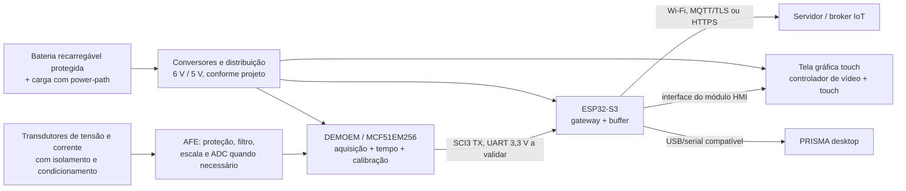

# PRISMA — Guia de ligação da placa DEMOEM/MCF51EM256

> **Estado:** guia de integração elétrica e arquitetura proposta, **não** homologação da placa do usuário. Baseado no repositório PRISMA e no manual oficial **DEMOEM User Manual rev. 1.02**. Antes de energizar, conferir a serigrafia, a revisão da PCB, os jumpers instalados, o esquema elétrico e as medições com multímetro. **Nenhum teste físico foi executado no equipamento.**

## 1. Objetivo e limite da placa

O hardware-alvo registrado no PRISMA é o **DEMOEM**, composto pela placa-base DEMOEM e placa-filha DCF51EM256 com microcontrolador **MCF51EM256 ColdFire V1**. Não há nesta versão do repositório arquivos de projeto da PCB, fotos da placa do usuário ou mapeamento físico validado da sua revisão.

A DEMOEM original contém: interface USB/BDM e serial virtual P&E, regulador de 3,3 V, entrada de alimentação por conector DC, suporte a 2 pilhas AAA, bateria CR2032 para o relógio IRTC, LCD de segmentos, quatro áreas de toque, gerador interno de sinais analógicos de demonstração com MC9S08QE8 e conectores para ADC/SCI/SPI.

**A DEMOEM não possui, por si só, tela gráfica touch, carregador de Li-ion/LiPo ou Wi-Fi.** Para essas funções, a opção de integração descrita abaixo é utilizar um **ESP32-S3 como gateway/HMI**, mantendo o ColdFire dedicado à aquisição.

| Tipo de indicação | Significado |
| --- | --- |
| **Confirmado em manual** | Conector ou recurso documentado pela NXP/P&E para a DEMOEM de referência |
| **Proposto** | Módulo, topologia e procedimento de integração; requer projeto e teste |
| **A verificar na placa** | Pinagem/posição/níveis elétricos que dependem da revisão e do esquema efetivo |

## 2. Visão geral das ligações propostas



Esse desenho é **funcional**, não substitui o esquema elétrico. Toda ligação entre o domínio das grandezas elétricas e o domínio digital/USB deve respeitar a **barreira de isolamento** estabelecida no projeto de medição.

## 3. Alimentação original — como ligar primeiro

**Especificações documentadas para a DEMOEM de referência:** alimentação por **USB 5 V DC (máximo 500 mA indicado no manual)** ou por **jack DC de 2,1/5,5 mm, 6 V DC com positivo no centro**; regulador embarcado produz VDD de aproximadamente **3,3 V**. O soquete para **2 pilhas AAA** é uma fonte **alternativa** de energia para a placa, não um carregador. Confirmar o consumo real dos periféricos antes de usá-los.

| Conector/jumper | Uso confirmado | Procedimento |
| --- | --- | --- |
| USB tipo B da DEMOEM | Alimentação e P&E Embedded Multilink | **Primeiro teste:** ligar ao PC/hub confiável, com a placa desligada e conexões externas removidas |
| Jack DC, 2,1/5,5 mm | Entrada externa **6 V DC, centro positivo** | Usar fonte estabilizada com limitação de corrente; **não** aplicar 9 V/12 V nem inverter polaridade |
| **J3** | Seleção entre `USB_PWR` e `EXT_PWR` | Manual: padrão USB, ponte **2–3**; a seleção externa utiliza a outra posição, mas confirmar numeração física antes de mover |
| **J4** | Seleção VDD (`REG_VDD`, `BAT_VDD`, indicação LED) | Configuração padrão citada pelo manual: **1–2 e 5–6**. Para pilhas ou modificações, consultar esquema específico e medir VDD |
| **J24** | Alimentação do barramento `MCU_PORT_VDD` | Normalmente instalado. Retirar/rever quando houver dispositivo externo com alimentação própria para evitar retorno de corrente |
| **J1 — MCU_PORT** | Expõe sinais do MCU e uma alimentação conforme configuração | **Não usar como entrada de tensão arbitrária**. Identificar fisicamente VDD/GND no esquema antes de qualquer conexão |
| **J37 + CR2032** | Bateria da alimentação `VBAT` do IRTC | Com J37 habilitado, mantém o domínio de relógio. **Não alimenta a placa, tela nem Wi-Fi**; não recarregar CR2032 |

**Passos de energização inicial:**

1. Desligar tudo. Fotografar os dois lados da DEMOEM, placa-filha, identificação de revisão e todos os jumpers.
2. Desconectar quaisquer sensores externos, ESP32, tela, bateria e instrumentos ligados à rede elétrica.
3. Conferir **J3/J4/J24** com o manual e usar somente **USB** para a primeira inicialização.
4. Energizar e medir VDD/GND (valor esperado próximo de 3,3 V para a configuração padrão), inspecionando aquecimento, consumo e estabilidade.
5. Confirmar dispositivos P&E/BDM e eventual COM no Windows. **USB/BDM detectado não garante COM funcional**.
6. Só depois avaliar o jack de 6 V ou a alimentação por bateria; **não unir saídas de fontes diferentes** e não presumir comutação automática.

## 4. Aquisição de grandezas reais (não simuladas)

### 4.1 O que a placa fornece

- O MCF51EM256 possui ADCs destinados à metrologia. No manual DEMOEM, **J29** dá acesso a `DADM0`, `DADM1` e `DADM2`: **na configuração de fábrica esses terminais negativos ficam conectados a GND por jumpers**.
- O manual identifica os correspondentes `DADP0`, `DADP1` e `DADP2` acessíveis pela área do conector **J38** (compartilhada com circuitos de demonstração).
- O **MC9S08QE8** gera sinais de teste de 50/60 Hz com PWM/filtragem; **J38** pode ligar as seis saídas PWM aos ADCs. Isso **não é medição de tensão/corrente da rede**.
- A existência de um nome de canal não garante que ele esteja livre, configurado, isolado, referenciado ou disponível para seis grandezas simultâneas. A topologia final depende do esquema e dos ADCs efetivos.

### 4.2 Caminho correto dos dados reais

| Etapa | Ligação/ação necessária | Verificação |
| --- | --- | --- |
| Tensão | Fonte real **através de transdutor de tensão isolado** adequado à faixa nominal | Isolação, relação de transformação, polaridade, amplitude e segurança |
| Corrente | **TC ou sensor Hall apropriado** → circuito de entrada dimensionado | Burden/proteção para TC, faixa, saturação, fase e segurança; **nunca abrir secundário de TC energizado** |
| Condicionamento | Proteção de entrada + filtro anti-aliasing + limitação de amplitude + referência/bias conforme ADC | Medir nível máximo e comum com osciloscópio/instrumento adequado antes de conectar ao MCU |
| Entrada do ADC | Saídas de **baixa tensão e compatíveis com o ADC** → `DADPx/DADMx` confirmados no esquema | Configuração de **J29/J38** e não existência de conexão simultânea ao gerador QE8 |
| Conversão | Firmware ColdFire com timer, aquisição sincronizada e timestamp | Frequência real de amostragem, perdas e eventual necessidade de ADC/AFE externo |
| Calibração | Aplicar referência conhecida em pelo menos três pontos por canal | Ganho, offset, fase, RMS, potência e THD comparados com instrumento de referência |

**Atenção:** os sinais de rede, inclusive em circuitos com neutro, nunca entram diretamente em `J29`, `J38`, `J1` ou no ADC. Não conectar USB/PC/touch a um circuito de medição cuja isolação entre rede e lógica não esteja comprovada. Validar primeiro com gerador de **baixa tensão isolado**, limitado aos valores seguros e permitidos no projeto.

**Medição trifásica completa:** para Va/Vb/Vc e Ia/Ib/Ic sincronizados, documentar **seis canais de grandeza**, sua simultaneidade e as compensações de fase. Se os recursos da DEMOEM não bastarem, adicionar **AFE/ADC multicanal sincronizado** externo por SPI (só após avaliar especificações e pinagem do ADC e do SPI). Não afirmar seis canais reais simultâneos sem essa verificação.

### 4.3 Desligar a demonstração antes dos sensores

1. Identificar e fotografar a posição atual de **J38** e **J29**; guardar os jumpers retirados.
2. Desabilitar a ligação do **PWM de demonstração** ao canal em que será conectado um sinal real, seguindo o esquema da revisão.
3. Definir se a entrada será **diferencial** ou referenciada ao GND. Para operação diferencial, a ponte de aterramento em `J29` **não** pode ser presumida correta: revisar ambos os terminais e o common-mode permitido.
4. Instalar o condicionamento **fora da placa**, isolado e previamente testado, e conectar somente a saída analógica condicionada.
5. Registrar em tabela: sensor, relação, borne do sensor, circuito condicionador, conector/pino DEMOEM, polaridade, GND/referência, ganho, fase, frequência de amostragem e ensaios.
6. Só marcar dados como **reais** após leitura calibrada e validação; sinal PWM da QE8 ou simulador do PRISMA deve continuar identificado como **demonstração**.

## 5. Comunicação serial — DEMOEM para PC ou ESP32-S3

O manual da DEMOEM confirma:

| Sinal / função | Referência da placa | Observação |
| --- | --- | --- |
| SCI1 | **J5** | Compartilha recursos com a interface infravermelha; verificar J16 e multiplexação |
| SCI3 | **J6** | **Preferência proposta** para telemetria, conforme disponibilidade física |
| Escolha da SCI TX | **J9 — TX_SEL** | Manual indica configuração padrão para SCI3 |
| Escolha da SCI RX | **J10 — RX_SEL** | Manual indica configuração padrão para SCI3 |
| Conexão ao receptor virtual P&E | **J7 — TX_EN** | Une TX do MCU à interface virtual; conferir sentido e posição na figura 7-4 |
| Conexão ao transmissor virtual P&E | **J8 — RX_EN** | Une TX da P&E ao RX do MCU; conferir a figura 7-5 |

**Opção A — demonstração/PC:** manter a interface P&E como único interlocutor da SCI, configurar `J9/J10` para o par escolhido e habilitar `J7/J8` segundo o manual; no Windows, identificar COM; no PRISMA, usar **115200 8N1** e firmware compatível.

**Opção B — ESP32-S3 e IoT (proposta):**

- Conectar **TX da SCI3 da DEMOEM (exposto em J6 e conferido no esquema) → RX UART do ESP32-S3**.
- Conectar **GND digital da DEMOEM → GND digital do ESP32-S3**, **somente se** ambos estiverem no mesmo domínio SELV isolado de redes e não houver risco de laço de terra. Caso contrário, usar **isolador digital de UART e alimentação isolada**.
- Opcional para comandos: **TX UART ESP32-S3 → RX SCI3 DEMOEM**, com configuração bidirecional e proteção adequadas. Para primeira leitura, manter apenas o sentido DEMOEM → ESP.
- Confirmar com medição **níveis lógicos e pinagem exata**: a proposta é UART TTL **3,3 V**, **não RS-232 ± tensão** nem ligação direta ao conector DB9. O RS-232 da DEMOEM pode nem estar montado.
- Evitar duas fontes dirigindo a mesma RX: usar a SCI **ou** para P&E **ou** para ESP (jumpers de interface virtual desabilitados no modo gateway, após conferir circuito). Alternativa: o **ESP recebe da DEMOEM e retransmite ao PRISMA desktop pela sua própria USB**, preservando o mesmo fluxo.
- Medir taxa e vazão. A **115200 baud, 8N1 ≈ 11.520 bytes/s** no limite bruto. Exemplo: 100 bytes/linha a 100 amostras/s ≈ 10.000 bytes/s antes de folga; 2.400 amostras/s do gerador demo **não cabem** automaticamente nessa serial.

O protocolo atual do PRISMA é **JSON por linha**, por exemplo:

```json
{"type":"sample","t":0.001,"va":110.2,"vb":-92.1,"vc":-18.3,"ia":4.1,"ib":-3.2,"ic":-0.9}
```

`t` é tempo em segundos, `v*` é tensão instantânea em volts, `i*` corrente instantânea em ampères. Os canais de corrente são **opcionais**: não enviar corrente fictícia zero se o sensor não existe. Para taxa elevada/THD alta, desenvolver transporte em blocos ou binário com sequência, CRC e sincronismo de tempo; manter a decodificação compatível no PRISMA.

**O firmware ColdFire para aquisição real ainda não está pronto:** `firmware/ports/mcf51em256_port.example.c` está bloqueado com `#error`. É necessário implementar a HAL real, definir pinmux e compilar/gravar com a toolchain adequada. Ver [bancada-demoem.md](bancada-demoem.md), [firmware](../firmware/README.md) e [protocolo](protocolo.md).

## 6. Tela gráfica touch-screen — ligação recomendada

**Não confundir interfaces:**

- O **LCD de segmentos** original da DEMOEM é conectado por **J26/J27**, com seleção FP/BP em **J25**. **Ele não é um barramento de vídeo para TFT**.
- Os quatro **touch pads** originais são habilitados por **J35**; são entradas capacitivas individuais, **não** um controlador de coordenadas X/Y.
- Uma tela TFT com toque exige interface de pixels (SPI, RGB, etc.), controlador de touch (I2C/SPI), memória, driver gráfico e dimensionamento de energia.

**Solução proposta:** um **módulo HMI com ESP32-S3 e tela touch integrada** (display e touch já compatibilizados pelo fabricante). Isso simplifica a integração:

| Conexão | Origem → destino | Critério |
| --- | --- | --- |
| Dados de metrologia | SCI3 TX DEMOEM → RX UART ESP32-S3 | Conferir J6, pinmux, 3,3 V e GND/isolação |
| Tela gráfica | ESP32-S3 → interface TFT do **próprio módulo HMI** | Seguir **pinout do fabricante da tela/HMI**, nunca usar J26/J27 da DEMOEM |
| Toque | Controlador touch do módulo HMI → ESP32-S3 | Interface/cabos definidos pelo fabricante; tipicamente I2C |
| Alimentação HMI | Conversor 5 V ou 3,3 V **especificado para o módulo** | Dimensionar backlight, pico de Wi-Fi e corrente, sem usar VDD da DEMOEM sem orçamento |
| Comandos para ColdFire (futuro) | TX UART ESP → RX SCI3 DEMOEM | Isolar ações perigosas; validar framing/CRC/ACK e permissões |

Tela inicial sugerida: **RMS trifásico, correntes, potências P/Q/S/FP, fasores, formas de onda, harmônicas/THD, alarmes, rede, bateria, data/hora e origem real/demo**. A interface mostra **dados não disponíveis** quando um canal não estiver medido. Controle remoto de cargas **não faz parte** desta primeira integração.

## 7. Bateria interna — arquitetura de alimentação recarregável proposta

A DEMOEM permite **duas pilhas AAA**, e tem **CR2032 para IRTC**; isso **não** fornece um sistema Li-ion recarregável nem garante energia suficiente para touch + Wi-Fi.

Para uma versão portátil, construir ou adquirir **módulo de alimentação externo apropriado**, sem soldar bateria diretamente nos pinos VDD/VBAT:

1. **1 célula Li-ion/LiPo protegida** (ou pack comercial certificado) e **circuito de carga correto para a química**, com proteção contra sobrecorrente, curto, subtensão e temperatura.
2. Controlador **power-path** para alimentar a carga enquanto a bateria carrega, com comutação de fonte segura.
3. **Saída regulada de 6 V** com corrente e polaridade adequadas ao **jack DC** da DEMOEM, **se** a via de 6 V for validada; nunca levar célula Li-ion diretamente ao jack ou ao compartimento AAA.
4. Saída **5 V/3,3 V regulada, independente e dimensionada** para ESP32-S3 e HMI, conforme as placas escolhidas.
5. Fusível/proteção, chave geral, medição de bateria (ADC/fuel gauge apropriado), aterramento/isolação, conectores com trava e gabinete sem acesso a partes perigosas.
6. Manter **CR2032/J37 apenas para backup do relógio**, se desejado. **Nunca carregar CR2032** nem ligar o carregador ao pino VBAT do IRTC.
7. Ensaiar partida, queda de tensão durante backlight e transmissão Wi-Fi, carregamento, temperatura, autonomia e desligamento seguro. **Não estimar horas de autonomia sem medir o consumo real**.

**Não combinar USB de programação, jack de 6 V e alimentação externa via MCU_PORT sem análise de OR-ing/retorno de corrente.** Durante programação pelo USB, verificar se o arranjo de bateria/boost poderá retroalimentar a porta do PC.

## 8. Comunicação IoT (ESP32-S3)

**Proposta de fluxo:** ColdFire adquire → ESP32-S3 recebe UART → valida amostra e adiciona `device_id`, contador, relógio sincronizado e qualidade → (a) atualiza HMI; (b) bufferiza dados em memória/flash; (c) publica **MQTT com TLS** ou HTTPS quando existir rede.

- **Wi-Fi 2,4 GHz** do ESP32-S3; provisionamento local protegido, sem deixar senhas no firmware de exemplo nem em arquivos públicos.
- MQTT: tópico sugerido `prisma/<device_id>/measurements` (definir limites de publicação e retenção). Use autenticação por dispositivo, TLS, relógio válido, reconexão exponencial e controle de autorização.
- Telemetria com `source=real|demo`, timestamp de coleta, sequência, unidades, frequência de amostragem, estado de calibração e sinalizador de perda; não apresentar dados sintéticos como reais.
- Buffer offline com limite de espaço e política de descarte documentada; publicar estado de conexão/bateria e confirmar entrega segundo QoS escolhido.
- A **SCI da DEMOEM não é Wi-Fi**: é necessário o gateway ESP32-S3 ou outro módulo de comunicação. **Nenhum código IoT/HMI embarcado está implementado no repositório nesta revisão.**
- Caso futuramente haja comando remoto, manter o caminho de potência/atuação **fisicamente separado**, com intertravamentos locais, autenticação e comportamento seguro quando perder comunicação.

## 9. Sequência de montagem e aceitação

| Fase | O que montar/testar | Critério de aceite |
| --- | --- | --- |
| **0 · Inventário** | PCB frente/verso, revisão, J3/J4/J24/J29/J38/J6/J7/J8/J9/J10/J37, manual e esquema | Fotos e tabela de pinos/níveis preenchidas |
| **1 · Alimentação** | Só DEMOEM por USB, sem periféricos externos | VDD dentro da especificação; ausência de curto/sobreaquecimento |
| **2 · Firmware e UART** | Implementar HAL ColdFire e transmitir amostras de **baixa tensão conhecida** | PRISMA lê COM sem perdas na taxa declarada |
| **3 · Aquisição real** | Condicionador/isolação, calibração e comparação com padrão | RMS, frequência, fase e potência com erro registrado |
| **4 · Gateway** | DEMOEM TX → ESP RX, validando níveis; retransmissão para PC | Mesmas amostras, ordem temporal, CRC/erros rastreados |
| **5 · Touch** | Display/touch HMI no ESP, alimentação própria | Toque correto; dados reais e ausentes identificados |
| **6 · Bateria** | Carregador power-path, proteção e DC/DC | Partida/carga/autonomia/testes térmicos e sem retorno para USB |
| **7 · IoT** | Wi-Fi + TLS + MQTT/HTTPS + buffer offline | Reconexão, controle de acesso, timestamps e perdas auditáveis |
| **8 · Sistema completo** | Gabinete e ensaios com carga/referência adequada | Relatório de teste e documentação de segurança completos |

**Pendências obrigatórias para um diagrama de fiação final numerado:** foto nítida frente/verso da placa do usuário, revisão da DEMOEM/DCF51EM256, esquema correspondente, sensor(es) escolhido(s), modelo específico de tela HMI, módulo de bateria/power-path e interface IoT efetiva. Sem isso, **não ligar componentes por numeração presumida de pinos**.

## 10. Fontes e documentos de projeto

- [NXP — DEMOEM User Manual rev. 1.02](https://www.nxp.com/docs/en/user-guide/DEMOEMUM.pdf): seção 2 (componentes e valores de alimentação), seção 7 (jumpers) e figuras 7-1 a 7-29.
- [NXP — página oficial DEMOEM (inclui esquemático Protel)](https://www.nxp.com/design/design-center/development-boards-and-designs/DEMOEM).
- [NXP — MCU MCF51EM256 e manual de referência](https://www.nxp.com/products/MCF51EM).
- [PRISMA — roteiro de bancada](bancada-demoem.md).
- [PRISMA — firmware](../firmware/README.md).
- [PRISMA — protocolo](protocolo.md).

**Regra de segurança:** a documentação orienta a arquitetura e o teste controlado. Não autoriza ligação de rede elétrica, montagem de carregador ou operação com sensores energizados sem projeto de isolamento, proteção e revisão por profissional habilitado.
