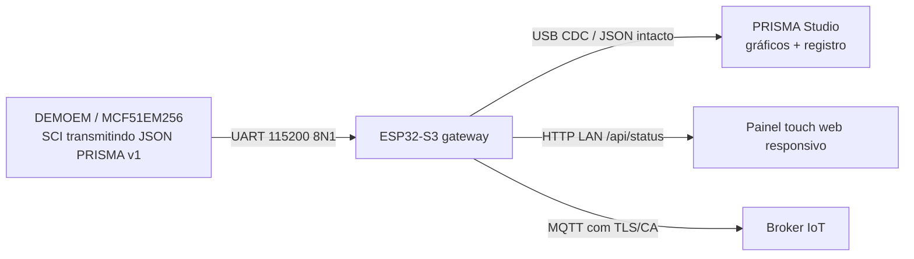

# PRISMA — gateway ESP32-S3 / HMI / IoT

**Estado: protótipo de firmware. Código publicado, sem compilação ou validação física da placa nesta sessão.**

Este projeto PlatformIO + Arduino para **ESP32-S3** é uma ponte entre a **DEMOEM/MCF51EM256** e o aplicativo PRISMA Studio. Não substitui os ADCs, não configura o ColdFire, não mede eletricidade por si só, não carrega baterias e não dirige uma tela TFT física.

## Fluxo implementado em código



- **UART só recepção**: o ESP não envia comandos à DEMOEM. Arquivo `src/main.cpp`.
- **USB CDC**: retransmite somente linhas PRISMA JSON reconhecidas `sample` e `status` para o PRISMA desktop; outras mensagens são descartadas e contadas. Isso permite usar o ESP como ponte sem alterar o parser do PC.
- **Resumo de 1 segundo**: estimativa RMS das componentes AC (subtraindo a média), correntes e potência ativa se **os três canais de corrente** existirem na amostra. Janelas com poucas amostras ficam inválidas; a leitura fica indisponível quando os dados ficam antigos. **Não calcula THD nem fasores** no ESP; esses cálculos permanecem no desktop.
- **Web HMI**: interface responsiva para toque no navegador, em `http://IP_DO_ESP/`, sem driver gráfico externo. Exibe valor indisponível quando a fonte real não envia dados.
- **IoT**: publica **resumos**, não todas as amostras, em `prisma/<device_id>/measurements`, usando MQTT/TLS com CA fornecida pelo operador. Desabilitado se faltarem credenciais/certificado.
- **Diagnóstico**: `GET /api/status` inclui idade da última amostra, linhas inválidas, excedentes, perdas no USB, resets de timestamp, estado de Wi-Fi/MQTT e contadores MQTT.
- **Bateria**: valor omitido (`null`) por padrão. Leitura ADC opcional apenas com divisor/proteção validados. **Não existe circuito ou código de carregamento**.

## Instalação e configuração

1. Instale VS Code + PlatformIO.
2. Abra a pasta `gateway/esp32s3` como projeto no PlatformIO. O perfil inicial é `esp32-s3-devkitc-1`: troque `board` conforme a placa ESP32-S3 efetivamente adquirida.
3. Copie `include/secrets.example.h` para `include/secrets.h`, ajuste `PRISMA_WIFI_SSID` e `PRISMA_WIFI_PASSWORD`. **Nunca versione** `secrets.h`.
4. MQTT é **opcional**. Para ativar, informe servidor, porta, usuário, senha e **CA PEM real** do broker em `secrets.h`. O código **não usa** `setInsecure()`. O relógio via NTP precisa sincronizar antes da sessão TLS.
5. Em `platformio.ini`, `PRISMA_UART_RX_GPIO=18` é **somente um exemplo de configuração ESP32-S3**. Confirme o pinout da placa, os pinos reservados, os níveis lógicos e a referência de GND **antes de ligar os fios**.
6. Compile e grave o ESP pelo PlatformIO, inicialmente **sem DEMOEM ligada**. Teste boot e Wi-Fi. Encontre o IP pela tabela de clientes DHCP do roteador. A interface web **não tem senha** e só deve estar em LAN confiável e isolada.
7. Depois de validar o firmware ColdFire e os níveis elétricos, conecte **SCI TX da DEMOEM → RX do ESP32-S3** (e terra lógico comum **somente** se o circuito tiver domínio SELV corretamente isolado); **não** conecte TX do ESP ao ColdFire nesta primeira versão.
8. Confirme SCI/pinmux/jumpers na documentação e desabilite a interface P&E se houver conflito de drivers com a SCI externa. **Não** conecte RS-232 diretamente à UART 3,3 V.
9. No PC, abra PRISMA, escolha a **porta COM do USB CDC do ESP32-S3**, a 115200 baud, e clique **Conectar serial**. Compare contagens no painel, `/api/status` e CSV do desktop.

Comandos PlatformIO na pasta `gateway/esp32s3`:

```bash
pio run
pio run -t upload
```

> `pio run` **não foi executado neste atendimento**. O build depende do Core/Arduino, PlatformIO e modelo de placa instalados no computador. O código é ponto de partida, não firmware homologado.

## Conectores e alimentação

| Interface | Origem | Destino | Cuidados |
| --- | --- | --- | --- |
| Alimentação da DEMOEM | USB 5 V ou DC 6 V centro positivo | Placa DEMOEM | Validar J3/J4/J24 e regulador original; não alimentar por ligação improvisada |
| Serial de medição | SCI3 TX DEMOEM (referência J6) | UART RX ESP32-S3 (GPIO configurado) | Confirmar esquema da revisão, multiplexação J9/J10/J7/J8 e lógica 3,3 V |
| Massa lógica | GND da DEMOEM | GND ESP | Só com isolamento SELV comprovado; caso contrário, usar isolador UART |
| USB para o PRISMA PC | USB do ESP32-S3 | Porta COM do Windows | Deve suportar USB CDC; não usar console de debug nessa porta |
| Tela touch | HTTP servido pelo ESP | Celular/tablet/touchscreen com navegador | Para TFT embutido, **falta escolher módulo e integrar driver gráfico/touch específico** |
| Alimentação ESP/HMI | DC/DC externo apropriado | ESP e eventual TFT | Dimensionar corrente de pico Wi-Fi + iluminação |
| Bateria interna | Pack protegido, BMS/carga power-path | DC/DC e equipamentos | **Projeto elétrico pendente**, não conectar células diretamente à DEMOEM ou ESP |

A placa original possui LCD de segmentos (J26/J27) e teclas capacitivas (J35); **isso não constitui uma interface de display TFT touch**.

## Fonte de dados e integridade

O gateway só processa amostras válidas no formato `{"type":"sample","t":0.001,"va":...,"vb":...,"vc":...}`. Correntes `ia/ib/ic` devem vir **juntas** ou estar ausentes. Não preenche campos não medidos com valores sintéticos.

A indicação **“dados recentes” não comprova que os sensores estejam calibrados**. O broker recebe `origin=DEMOEM-serial-unverified` enquanto não houver homologação. O tratamento de mensagens funciona em melhor esforço: a telemetria USB pode ser descartada sob congestionamento, com contador `usb_drops`. UART 115200 baud (8N1) tem limite físico nominal de ~11,5 kB/s, insuficiente para muitas amostras JSON quando se deseja análise até harmônica 15. Um protocolo binário com CRC, sequência e gerenciamento de vazão é etapa futura.

## Segurança e limitações

- **Não conectar rede elétrica diretamente ao microcontrolador**, ao ESP, à USB do computador ou a qualquer entrada do ADC. Sensores e condicionamento devem ser isolados, protegidos e testados com baixa tensão primeiro.
- A interface HTTP local **não possui autenticação**, HTTPS nem endurecimento de segurança; não disponibilizar na internet ou em redes compartilhadas.
- Wi-Fi, MQTT, tela física, bateria e firmware ColdFire dependem de configuração e testes específicos do hardware.
- Não foi realizado ensaio de autonomia, compatibilidade de energia simultânea USB/DC ou performance em produção.
- Para mapa de jumpers, alimentação, aquisição e ensaios, consultar [guia de ligações da DEMOEM](../../docs/ligacoes-hardware-demoem.md).
