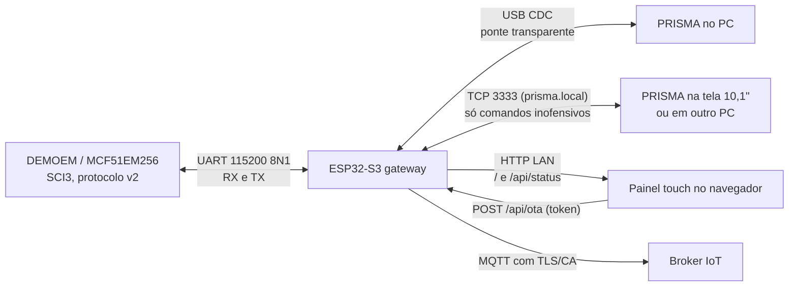

# PRISMA — gateway ESP32-S3 / HMI / IoT

**Estado:** o firmware compila no PlatformIO para o ESP32-S3 DevKitC-1. O núcleo (protocolo v2, resumos e atualização da DEMOEM) foi testado no PC contra o bootloader simulado. **Ainda não foi gravado num ESP32-S3 nem ligado à DEMOEM.**

Este projeto PlatformIO + Arduino faz a ponte entre a **DEMOEM/MCF51EM256** e o PRISMA no PC. Também serve um painel web, publica MQTT e atualiza o firmware da DEMOEM por Wi-Fi. Ele não substitui os ADCs, não carrega baterias e não dirige uma tela TFT física.

## Fluxo



- **Ponte transparente** (`src/main.cpp`): os bytes da placa vão intactos para a USB, e o PRISMA no PC decodifica o JSON e os quadros v2 como faz com o CH340. Os comandos do PC (identificar placa, rajadas, `scripts/atualizar_demoem.py`) vão da USB para a placa. Sem espaço na USB, o pedaço se perde e o PC descarta o quadro pelo CRC; o gateway conta esses bytes em `usb_drop_bytes`.
- **PRISMA pela rede** (porta TCP `PRISMA_TCP_PORT`, padrão 3333): os mesmos bytes da ponte USB vão para um cliente TCP. O app conecta em `prisma.local:3333`, em "Gateway na rede…" ou com `--port`, e reconecta sozinho. Da rede para a placa só passam INFO, RAJADA e AUTOCALIBRAÇÃO; o bootloader fica fora ([protocolo](../../docs/protocolo.md#pela-rede-tcp)). O nome vem de `PRISMA_HOSTNAME` (padrão `prisma`), anunciado por mDNS junto com o serviço `_prisma._tcp`.
- **Resumos da medição contínua** (`lib/prisma_link`): o gateway lê os quadros `0x02` (uma janela de ciclos inteiros por ~1 s). Ele calcula RMS AC, potência ativa e frequência com as somas inteiras exatas, como o `MeterSummary` do PC. As rajadas `0x01` (até 48 KB) têm o CRC conferido sem ficar na memória.
- **Unidades:** sem ganhos, os valores saem em contagens do ADC (`v_unit: "counts"`). Com `PRISMA_CAL_GAINS` em `secrets.h`, eles saem em V, A e W. Use o `gain` de cada canal do perfil de calibração do PC. O `offset` não afeta o RMS AC. O `delay_us` (≈ 40 µs das correntes) não é compensado no ESP: o erro em P é de ~0,9° de fase, ou seja, < 0,02 % com FP 1 e maior com carga reativa.
- **Atualização da DEMOEM** (`POST /api/ota`): recebe o S19 do `EM256 App` e grava pelo bootloader PRISMA ([docs/bootloader.md](../../docs/bootloader.md)). O fluxo e as garantias são os do gravador do PC: a aplicação só roda depois de a placa conferir o CRC-32, e uma gravação interrompida deixa a placa no bootloader. Fica **desligada** sem `PRISMA_OTA_TOKEN` (mínimo de 12 caracteres) e sem os dois pinos da UART. Durante a gravação, o ESP é dono da UART: a ponte USB e os resumos param.
- **Painel web** em `http://IP_DO_ESP/`: valores por fase, frequência, diagnóstico e a aba "Atualizar DEMOEM".
- **IoT:** publica um resumo por janela em `prisma/<device_id>/measurements` (`schema: prisma.gateway.v2`), por MQTT/TLS com a CA do operador. Fica desligado se faltarem credenciais ou o certificado; o código não usa `setInsecure()`.
- **Bateria:** valor `null` por padrão. A leitura ADC é opcional e exige divisor e proteção validados. Não existe circuito nem código de carga.

### API HTTP

| Rota | O que faz |
| --- | --- |
| `GET /api/status` | Medição da última janela (`seq`, `window_s`, `f_Hz`, `vrms`, `irms`, `p`, unidades), idade, janelas perdidas, quadros, erros de CRC, bytes perdidos na USB, última mensagem da placa, cliente TCP e comandos recusados da rede, Wi-Fi e MQTT. |
| `GET /api/ota` | Estado da atualização: `idle`, `receiving`, `flashing`, `done` ou `failed`; etapa, progresso, reenvios, tamanho e CRC-32 da imagem, mensagem. |
| `POST /api/ota` | Upload multipart do S19 com o cabeçalho `X-Prisma-Token`. Responde 202 e grava em segundo plano. |

Pelo terminal:

```bash
curl -H "X-Prisma-Token: $TOKEN" -F "image=@firmware/codewarrior/EM256 App/bin/Project.abs.S19" http://IP_DO_ESP/api/ota
curl http://IP_DO_ESP/api/ota
```

## Instalação e configuração

1. Instale o PlatformIO (`uv tool install platformio` ou a extensão do VS Code).
2. O perfil é `esp32-s3-devkitc-1`. Troque `board` em `platformio.ini` conforme a placa adquirida.
3. Copie `include/secrets.example.h` para `include/secrets.h` e ajuste o Wi-Fi. **Nunca versione** `secrets.h`. MQTT, o token de atualização e os ganhos são opcionais.
4. `PRISMA_UART_RX_GPIO=18` e `PRISMA_UART_TX_GPIO=17` são **exemplos**. Confirme o pinout, os pinos reservados, os níveis lógicos (3,3 V) e o GND **antes de ligar os fios**. Com `PRISMA_UART_TX_GPIO=-1`, o gateway só recebe.
5. Compile e grave o ESP **sem a DEMOEM ligada**. Teste o boot e o Wi-Fi, e encontre o IP na tabela DHCP do roteador.
6. Ligue **TX3 da DEMOEM (PTC1, J6) → RX do ESP** e **TX do ESP → RX3 da DEMOEM (PTC0, J6, com J10 no PTC0)**. Nunca ligue RS-232 direto na UART de 3,3 V. O terra lógico comum só vale com domínio SELV isolado; caso contrário, use isolador de UART.
7. No PC, abra o PRISMA, escolha a **porta COM do USB CDC do ESP32-S3** a 115200 baud e conecte. Ou escolha **Gateway na rede…** e informe `prisma.local` (ou o IP). Compare as contagens do painel, do `/api/status` e do PC.

Antes de ter o ESP, o mesmo fluxo de rede pode ser testado com a ponte do PC: `uv run python scripts/ponte_tcp.py COM3` (ou `--demo`, sem placa).

```bash
cd gateway/esp32s3
pio run              # compila
pio run -t upload    # grava o ESP32-S3
```

## Testes

`tests/test_gateway.py` compila `lib/prisma_link` com g++ no PC e confere:

- o filtro de comandos da rede, que deixa passar os mesmos quadros que o `CommandGate` do PC;
- o separador de quadros e o resumo `0x02` contra o decodificador Python, com texto, rajada grande, CRC errado, cabeçalho impossível e linha longa;
- os ganhos;
- a montagem do S19, que dá a mesma imagem e o mesmo CRC do PC e recusa o que está fora da área, na faixa reservada ou repetido;
- a gravação de ponta a ponta no núcleo C real do bootloader (`prisma_boot.h`) com flash simulada. Cobre quatro casos: placa já no bootloader, placa rodando a aplicação (comando `0x04`), respostas perdidas e quadros da aplicação misturados com as respostas. Também grava a imagem compilada do `EM256 App`.

## Conectores e alimentação

| Interface | Origem | Destino | Cuidados |
| --- | --- | --- | --- |
| Alimentação da DEMOEM | USB 5 V ou DC 6 V centro positivo | Placa DEMOEM | Validar J3/J4/J24 e o regulador original |
| Serial da placa | SCI3 TX (PTC1, J6) | UART RX do ESP32-S3 | Confirmar o esquema da revisão, J9/J10/J7/J8 e a lógica de 3,3 V |
| Comandos e atualização | UART TX do ESP32-S3 | SCI3 RX (PTC0, J6; J10 no PTC0) | Hoje o RX3 ainda não recebe com o CH340 ([bancada](../../docs/bancada-demoem.md)) |
| Massa lógica | GND da DEMOEM | GND do ESP | Só com isolamento SELV comprovado; senão, isolador de UART |
| PRISMA no PC | USB do ESP32-S3 | Porta COM do Windows | USB CDC; nenhum texto de depuração nessa porta |
| Tela touch | HTTP servido pelo ESP | Navegador | TFT embutido: falta escolher o módulo e integrar o driver |
| Alimentação ESP/HMI | DC/DC externo | ESP e eventual TFT | Dimensionar o pico do Wi-Fi e a iluminação |
| Bateria interna | Pack protegido, BMS/carga power-path | DC/DC | **Projeto elétrico pendente** |

O LCD de segmentos (J26/J27) e as teclas capacitivas (J35) da placa original não são uma tela TFT touch.

## Segurança e limitações

- **Não ligar a rede elétrica direto no microcontrolador**, no ESP, na USB do computador ou em entrada de ADC. Sensores e condicionamento devem ser isolados, protegidos e testados primeiro com baixa tensão.
- A leitura HTTP não tem autenticação nem HTTPS. A atualização exige o token, mas ele trafega em HTTP sem TLS. Use só em LAN isolada e confiável, nunca exposta à internet.
- A indicação "medindo" não comprova sensores calibrados. O broker recebe `origin=DEMOEM-serial-unverified` enquanto não houver homologação.
- Wi-Fi, MQTT, tela física, bateria e a própria ponte dependem de testes no hardware real.
